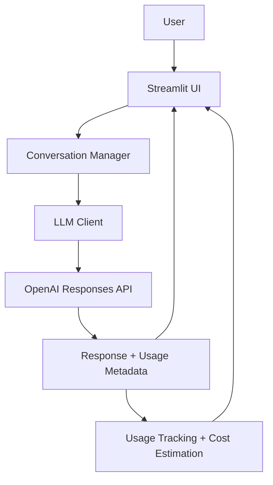

# Architecture Overview

## High-level architecture

## Component responsibilities

### User interface
The Streamlit app handles input, message display, sidebar controls, analytics, and user flow. It keeps the experience simple and readable without embedding business logic for the model request itself.

### Conversation manager
The conversation manager keeps a list of user and assistant messages in a correct order. It is responsible for building the request payload that gets sent to the model when a new question arrives.

### LLM client
The LLM client is the shared service layer for API calls. It handles:
- non-streaming responses
- streaming responses
- model selection
- request payload generation
- error handling for invalid or missing config

### OpenAI Responses API
The app calls the official OpenAI SDK and uses `client.responses.create(...)`. It sends either a single prompt or a history-based input list, depending on whether the app is in direct or multi-turn mode.

### Streaming event handling
If streaming is enabled, the app consumes response events and combines deltas into a final text answer. Completion and failure states are tracked separately so partial output is never treated as a successful reply.

### Model selection
The app reads the configured default model from `OPENAI_MODEL` and optionally adds more model IDs from `OPENAI_MODELS`. The dropdown stores the selected model in Streamlit session state and passes it into the LLM request.

### Usage tracking
When the API returns usage metadata, the project extracts token counts, cached-token values, reasoning tokens, and response latency.

### Cost estimation
Cost calculation is kept in a dedicated module, using model pricing tables and Decimal-safe arithmetic so values remain readable and consistent.

### Session state
Streamlit session state holds:
- visible conversation messages
- recent model context payload
- streaming toggle
- selected model
- usage history and costs

That separation keeps UI reruns predictable and prevents different browser sessions from sharing state inappropriately.
